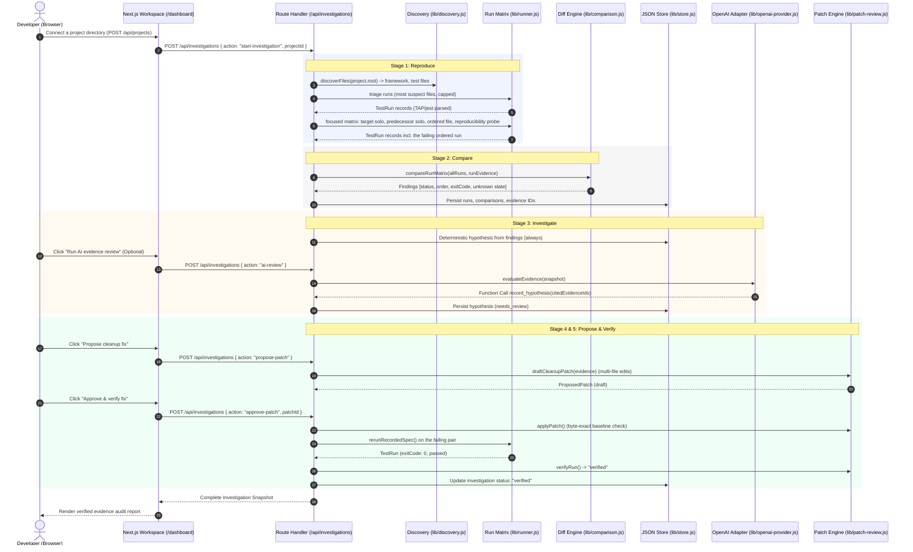

<p align="center">
  
</p>

<p align="center">
  <strong>Don't guess the bug. Prove it.</strong>
</p>

<p align="center">
  An evidence-first debugging workspace for inconsistent and order-dependent test failures.
</p>

<p align="center">
  <a href="https://github.com/pranavgawaii/codex-breakpoint/actions/workflows/ci.yml">
    
  </a>
</p>

---

## Quick Start (30 Seconds)

Breakpoint runs a fully functional local debugging workflow out of the box without requiring external API keys:

```bash
# 1. Clone and enter the repository
git clone https://github.com/pranavgawaii/codex-breakpoint.git
cd codex-breakpoint

# 2. Install dependencies (Node 20+ required)
npm install

# 3. Start the application
npm run dev
```

Open [http://localhost:3000](http://localhost:3000) for the overview or [http://localhost:3000/app](http://localhost:3000/app) to connect a project — the bundled trusted sample, or any local directory you register. Then start an investigation and let the controlled workflow reproduce, compare and verify the failure.

---

## The Problem

Every engineering team has encountered this scenario:

> A test passes reliably when run alone in isolation (`npm test -- test/session.test.js`), but fails unpredictably when executed as part of the full test suite (`npm test`).

Developers typically respond by:
1. Re-running the suite hoping it was a fluke.
2. Dumping pages of `console.log` statements into test files.
3. Guessing at race conditions or timing issues.
4. Asking an LLM to "fix the bug" without giving it execution context—often producing plausible-looking patches that fail when applied.

### Why this happens

In modern test suites, tests that share a process often share hidden state:
- **Module-level variables** mutated during authentication or caching.
- **Global mocks or singletons** that are not cleaned up in `afterEach` hooks.
- **Database or filesystem remnants** left behind by previous assertions.
- **Execution order dependencies** where Test B only passes if Test A ran beforehand, or fails if Test A ran first.

Reading static log dumps cannot prove causation because logs show what happened, not why the state diverged from the passing baseline.

---

## What Breakpoint Does

Breakpoint treats flaky test debugging like a forensic investigation rather than a guessing game:

1. **Executes Controlled Comparisons**: Runs the target test in isolation, the suspect test in isolation, the pair in original order, the pair in reversed order, and repeats the sequence.
2. **Collects Verifiable Evidence**: Parses machine-readable test events (TAP protocol) and binds findings to specific run identities (`run_xxx`).
3. **Labels Uncertainties Explicitly**: When application heap state was not captured, Breakpoint explicitly tags findings as `unknown` rather than hallucinating internal transitions.
4. **Constrains AI with Strict Evidence Citations**: When OpenAI review is enabled, the model can only formulate hypotheses by citing existing evidence IDs. If the model references an unobserved fact, the tool call is rejected by the server.
5. **Gates Fixes Behind Approval & Verification**: Generates a targeted cleanup patch, displays the exact diff, applies it only after human confirmation, and immediately re-runs the failing sequence to verify the fix.

---

## How It Works

Breakpoint follows a five-stage verification cycle:

```
┌─────────────┐     ┌───────────┐     ┌─────────────┐     ┌───────────┐     ┌──────────┐
│  Reproduce  │ ──► │  Compare  │ ──► │ Investigate │ ──► │  Propose  │ ──► │  Verify  │
└─────────────┘     └───────────┘     └─────────────┘     └───────────┘     └──────────┘
  Isolated vs         Differential       Evidence-Cited      Approval-Gated    Post-Patch
  Ordered Runs        Analysis           Hypotheses          Code Fix          Rerun
```

### Flow Architecture



---

## Key Features (Verified in Code)

- **Registered-Project Discovery (`lib/discovery.js`)**: Walks a registered directory (capped), detects the test framework, and builds run commands from the project's own test files and binaries. The browser cannot supply arbitrary shell commands, working directories, or execution parameters.
- **Argv-Only Process Execution (`lib/spawn-safe.js`)**: Executes real test runs using `child_process.spawn` with `shell: false`, a scrubbed child environment, and executable paths resolved from the project's own `node_modules/.bin`.
- **Process Safety Controls (`lib/runner.js`)**: Enforces a strict execution timeout via `SIGKILL` and stdout/stderr byte-cap truncation; runs never inherit secrets from the server environment.
- **TAP/jest Output Parser (`lib/runner.js`)**: Ingests TAP output from Node's native test runner (`node --test`) and jest-style summaries, extracting individual subtest names, run durations, exit codes, and failure assertion messages.
- **Static Shared-State Analysis (`lib/state-analysis.js`)**: Strips comments and strings, then audits module-level writes, exported mutable handles, global timers and cross-test coupling to rank suspect files and select an investigation target before any run.
- **Differential Run Comparison Engine (`lib/comparison.js`)**: Contrasts failing and passing runs across the matrix — status, exit codes, execution sequence, and assertion errors. Explicitly creates records with `certainty: "unknown"` for uncaptured runtime memory state.
- **Single-Tenant Operation Serialization (`lib/lock.js`)**: Mutating actions (`run-workflow`, `ai-review`, `approve-patch`) are protected by an in-memory lock that returns HTTP 409 Conflict if a concurrent mutation is initiated.
- **Local-First Atomic Store (`lib/store.js`)**: Persists runs, evidence, comparisons, analyses, and patches to `.breakpoint/investigations.json` using atomic temporary file creation (`mode 0o600`) and renaming, protecting against partial writes.
- **Constrained AI Function Calling (`lib/openai-provider.js`)**: Integrates with OpenAI's Responses API using strict function definitions (`record_hypothesis`). Server-side validation requires that all cited supporting and contradicting evidence IDs exist in the active investigation; hallucinatory citations result in immediate rejection.
- **Approval-Gated Safe Patching (`lib/patch-review.js`)**: Patches are generated as immutable drafts holding per-file edits. Before writing to disk, Breakpoint verifies that every target file matches its recorded byte-exact baseline. An approval click is required to apply the patch, and a subsequent rerun must pass before marking the issue "verified".
- **One-Click Patch Rollback (`lib/patch-review.js`)**: Restores every patched file's original baseline contents cleanly with a single click (`action: "revert-patch"`).

---

## Example Debugging Scenario

Breakpoint includes a real, reproduction-ready sample project in `sample-project/`.

### The Bug

In `sample-project/src/session.js`:

```javascript
let activeUser = null;

export function authenticate(user) { activeUser = user; }
export function currentUser() { return activeUser; }
export function clearSession() { activeUser = null; }
```

In `sample-project/test/session-flow.test.js`:

```javascript
import test from "node:test";
import assert from "node:assert/strict";
import { authenticate, currentUser } from "../src/session.js";

test("authentication establishes the demo user", () => {
  authenticate("demo-user-1");
  assert.equal(currentUser(), "demo-user-1");
});

test("session starts without a user", () => {
  assert.equal(currentUser(), null, "session should be empty at test setup");
});
```

### The Failure Sequence

1. **Isolation Run**: Running only `session starts without a user` succeeds:
   ```bash
   node --test --test-name-pattern "session starts without a user" test/session-flow.test.js
   # Result: ✔ session starts without a user (exit code: 0)
   ```
2. **Sequential Suite Run**: Running the full test file fails:
   ```bash
   node --test test/session-flow.test.js
   # 1. authenticate establishes the demo user -> PASS (mutates activeUser to "demo-user-1")
   # 2. session starts without a user -> FAIL (assertion error: 'demo-user-1' !== null)
   ```
3. **Reversed Sequence Run**: Running in reverse order in `test/reverse-flow.test.js` succeeds:
   ```bash
   node --test test/reverse-flow.test.js
   # 1. session starts without a user -> PASS (activeUser was null)
   # 2. authenticate establishes the demo user -> PASS
   ```

### How Breakpoint Proves It

- Runs all three variations back-to-back and records stdout/stderr, durations, and TAP events.
- Compares Run 3 (failing ordered run) against Run 4 (passing reversed run).
- Discovers that the test failure is strictly order-dependent, linking the finding to evidence IDs `ev_xxx`.
- Proposes a cleanup patch to reset state between runs:
  ```diff
  + test.beforeEach(() => clearSession());
  ```
- Applies the patch, reruns the failing ordered pair, confirms exit code 0, and archives the investigation as **Verified**.

---

## Technology Stack

Derived directly from `package.json` and active code:

| Component | Technology | Purpose |
|---|---|---|
| **Framework** | Next.js 15.5.28 (App Router) | Server-rendered UI, dynamic route handlers (`/api/investigations`), and static report generation. |
| **Frontend Library** | React 19.1.10 | Client components for real-time investigation stepper, diff view, and tabbed run inspection. |
| **Language & Types** | JavaScript (ESM, Node ≥ 20) | Zero-TypeScript codebase. Data shapes are documented with JSDoc typedefs (`lib/models.js`); everything runs natively without a compile step. |
| **Test Runner** | Node.js Native Runner (`node --test`) | Native TAP-compliant runner executed via subprocesses without external testing framework dependencies. |
| **AI Integration** | OpenAI Node SDK (`^6.16.0`) | Structured hypothesis evaluation using the OpenAI Responses API with function tool constraints. |
| **Styling** | Vanilla CSS | Bespoke design system based on warm paper aesthetic, Outfit and Redaction 35 typography, and hairline borders. |
| **Persistence** | Node.js `fs/promises` | Atomic local file writes to `.breakpoint/investigations.json`. |

---

## Getting Started

### Prerequisites

- **Node.js**: v20.0.0 or higher (required for native `node --test` runner).
- **npm**: v10.0.0 or higher.
- **Git**

### Installation

1. Clone the repository:
   ```bash
   git clone https://github.com/pranavgawaii/codex-breakpoint.git
   cd codex-breakpoint
   ```

2. Install dependencies:
   ```bash
   npm install
   ```

3. Configure environment variables (optional):
   ```bash
   cp .env.example .env.local
   ```

   Edit `.env.local` to enable optional AI hypothesis review:
   ```bash
   # Required only if you want AI-assisted evidence review
   OPENAI_API_KEY=your_openai_api_key_here

   # Optional: Model override (defaults to gpt-5.4)
   OPENAI_MODEL=gpt-5.4

   # Optional: Override investigation store directory (defaults to .breakpoint/)
   # BREAKPOINT_DATA_DIR=/path/to/custom/dir
   ```

   > **Note**: An OpenAI API key is **not required** to use Breakpoint. The full five-step controlled workflow, differential comparison engine, deterministic hypothesis generation, patch proposal, and fix verification operate 100% locally and deterministically.

4. Start the development server:
   ```bash
   npm run dev
   ```

   Navigate to [http://localhost:3000](http://localhost:3000).

---

## Project Structure

```
codex-breakpoint/
├── app/                                 # Next.js App Router
│   ├── api/projects/route.js            # REST API: list + register local projects
│   ├── api/investigations/route.js      # REST API: workflow, triage, AI review, patches
│   ├── app/page.jsx                     # Project connector (register any local directory)
│   ├── components/                      # Reusable UI components
│   │   ├── brand-mark.jsx               # SVG brand marks and glyphs
│   │   ├── diff-view.jsx                # Patch diff inspector
│   │   ├── investigation-window.jsx     # Embedded interactive demo window
│   │   ├── product-chrome.jsx           # Global navigation and status indicators
│   │   └── site-footer.jsx              # Clean editorial footer
│   ├── dashboard/                       # Interactive investigation workspace
│   │   ├── dashboard.css                # Workspace-specific stylesheets
│   │   ├── page.jsx                     # Dashboard route entry point
│   │   └── workspace.jsx                # Guided flow, run tabs, patch reviewer
│   ├── investigations/
│   │   ├── inv_session_state/           # Legacy route -> workspace; forensic summary report
│   │   └── new/page.jsx                 # Fixed execution-matrix run plan
│   ├── layout.jsx                       # Root layout and font declarations
│   ├── not-found.jsx                    # 404 error page
│   ├── page.jsx                         # Landing page with interactive live demo
│   ├── runtime.css                      # Utility and layout styling
│   └── styles.css                       # Design system tokens and typography
├── lib/                                 # Core backend & business logic (plain ESM JS)
│   ├── agent.js                         # Deterministic hypothesis builder
│   ├── comparison.js                    # Matrix-aware differential run comparison
│   ├── discovery.js                     # File walk, framework detection, argv builder
│   ├── errors.js                        # Typed application errors (Conflict, AiUnavailable)
│   ├── investigations.js                # Orchestrator for projects, workflows, and store
│   ├── lock.js                          # Single-tenant in-memory operation lock
│   ├── models.js                        # JSDoc typedefs (TestRun, Evidence, Patch, ...)
│   ├── openai-provider.js               # OpenAI Responses API function-calling adapter
│   ├── patch-review.js                  # Unified diff engine, patch applier, reverter, verifier
│   ├── projects.js                      # Registration safety gates + static analysis entry
│   ├── spawn-safe.js                    # Argv-only spawn helper (no shell, scrubbed env)
│   ├── state-analysis.js                # Static shared-state scanner + target selection
│   ├── runner.js                        # Triage/matrix run specs + TAP/jest parsing
│   └── store.js                         # Atomic JSON persistence (.breakpoint/investigations.json)
├── sample-project/                      # Trusted local reproduction target
│   ├── src/
│   │   └── session.js                   # Source with shared module-level state
│   └── test/
│       ├── reverse-flow.test.js         # Passing reversed test pair
│       └── session-flow.test.js         # Failing ordered test pair
├── public/brand/                        # SVG and PNG brand marks
├── package.json                         # Dependencies, build scripts, ESM marker
└── jsconfig.json                        # Path alias (@/*) configuration
```

---

## API Surface

### `POST /api/projects`
| Field | Notes |
|---|---|
| `root` | Absolute path of a directory on this machine. Must exist, must not sit inside a forbidden system root (`/etc`, `/usr`, `/bin`, ...). |
| `trusted` | Opt-in confirmation that Breakpoint may execute this project's tests and, only after explicit patch approval, write inside it. |

Returns `{ project, discovery: { framework, testFiles, truncated } }`.

### `GET /api/investigations`
Returns the active investigation snapshot: investigation record (including the resolved `target`), owning project, public runs, evidence, comparisons, static analyses, hypotheses, patches and verifications.

### `POST /api/investigations` actions
| Action | Body | Effect |
|---|---|---|
| `start-investigation` | `{ projectId }` | Creates a fresh investigation for a registered project and makes it active. |
| `scan-project` | `{ projectId? }` | Runs the static shared-state analysis only (no subprocesses) and persists findings as evidence. |
| `run-workflow` | `{ testFile?, targetTest? }` | Full pipeline: static triage → triage runs → resolved target → focused matrix → comparison → hypothesis. |
| `run-demo` | — | Legacy alias of `run-workflow` against the bundled trusted sample. |
| `ai-review` | — | Optional. OpenAI reviews the evidence trail and records a hypothesis via one function call. |
| `propose-patch` | — | Drafts a minimal multi-file cleanup patch from evidence; stays unapplied. |
| `approve-patch` | `{ patchId }` | Applies the draft (byte-exact baseline check), reruns the failing pair, records verification. |
| `revert-patch` | `{ patchId }` | Restores every patched file to its baseline; records the revert. |

---

## Available Scripts

All scripts have been verified and tested:

```bash
# Start local development server with Turbopack support
npm run dev

# Check linting rules across all source files
npm run lint

# Build optimized production bundle
npm run build

# Start production server
npm run start

# Run the sample project's tests directly in Node.js
node --test sample-project/test/session-flow.test.js
```

---

## Architecture and Security

### Subprocess Execution Model

Breakpoint runs test commands using `node:child_process.spawn` via `lib/spawn-safe.js`:
- **Shell-free execution**: `shell: false` with argv arrays only — input strings are never parsed or expanded by bash/sh, eliminating shell injection vulnerabilities.
- **Project-local binary allowlist**: Executables come from the project's own `node_modules/.bin` (plus `node`); commands are built by Breakpoint from discovered test files. The browser can never specify arbitrary arguments or executables.
- **Registered working directory**: Execution is locked to the registered project root. Registration rejects paths inside forbidden system roots (`/etc`, `/usr`, `/bin`, `/sbin`, `/System`, `/Windows`, ...).
- **Sanitized environment**: Subprocesses receive a minimal, scrubbed environment (`NODE_ENV: "test"`, capped `NODE_OPTIONS`) with no secrets forwarded.
- **Hard output caps and timeouts**: Every run has a wall-clock timeout and stdout/stderr byte caps, recorded verbatim in the store.

### Important Security Boundary Disclosures

> **Warning: This prototype runs Node.js subprocesses on the host machine.**
> 
> Ordinary child process execution with restricted parameters is a **harness boundary**, not a **virtualized sandbox**. Subprocesses running on the host retain filesystem access permitted by user permissions. 
> 
> Do not point Breakpoint at untrusted third-party repositories or execute unknown scripts outside a hardened virtual container (e.g., Docker, Firecracker, or gVisor).

### AI Security & Prompt Injection Mitigation

1. **Schema-enforced function calling**: OpenAI is strictly invoked using structured tool parameters (`record_hypothesis`). Free-form text output is ignored in favor of validated tool arguments.
2. **Evidence ID validation**: The server verifies that every ID passed in `supportingEvidenceIds` and `contradictingEvidenceIds` exists in `.breakpoint/investigations.json`. Hallucinated IDs cause immediate rejection.
3. **Prompt boundary enforcement**: Test outputs and repository contents are provided as structured data values, never as prompt instructions.
4. **Zero execution privileges for AI**: The AI model has no tool access to run commands, edit files, or mark investigations as verified. Only human user actions can approve patches or trigger runs.

---

## Current Status & Limitations

### Working Today
- Any local directory can be registered (with explicit trust confirmation) and investigated — not just the bundled sample.
- Static shared-state analysis produces ranked, evidence-backed findings without executing anything.
- Node.js test execution with TAP/jest output parsing, driven by triage + focused matrix runs.
- Differential comparison across the run matrix with explicit "unknown" markers.
- Deterministic hypothesis formulation with cited analysis evidence.
- Optional OpenAI Responses API integration with verified evidence citation.
- Multi-file, baseline-checked, approval-gated patch proposal, application, and reversion.
- Post-fix rerun and verification recording against the exact recorded run spec.
- Comprehensive UI workspace and forensic summary report.

### Current Limitations
- **Subprocess Isolation**: Runs locally on the host; not containerized in Docker. Trust confirmation gates execution, but it is not a sandbox.
- **Language Scope**: Currently supports Node.js (`node --test`) plus jest/vitest via their native binaries. Python (`pytest`), Go (`go test`), and Rust (`cargo test`) are planned.

---

## Roadmap

- [ ] **Docker / MicroVM Sandboxing**: Execute test commands inside ephemeral containers to safely analyze untrusted repositories.
- [ ] **Multi-Language Runner Adapters**:
  - Python (`pytest --junitxml`)
  - Go (`go test -json`)
  - Rust (`cargo test -- --format=json`)
- [ ] **Automated Bisecting for Order Dependencies**: Automatically execute permutations of test sequences to isolate the exact predecessor test that causes state corruption.
- [ ] **GitHub Actions / CI Bot**: Run Breakpoint automatically when a flaky test failure is detected in CI, attaching a full investigation snapshot to the pull request.

---

## Hackathon Context

Breakpoint was created for the **DevDay Exchange Community Metro Hackathon: Pune** (Codex-powered build sprint).

- **Track**: Developer Tools / Software Reliability
- **Core Premise**: Moving beyond generative "code assistants" that guess bug fixes, toward structured developer tools that gather forensic evidence, reproduce failure conditions, and verify code fixes with actual test runs.
- **Pitch Deck**: [View Breakpoint Pitch Deck (6 slides, PDF)](docs/breakpoint-pitch-deck.pdf)

---

## License

All rights reserved — see [`LICENSE`](LICENSE). This project was developed for a hackathon demonstration and is publicly viewable for evaluation only.

Font assets in `public/fonts/` (Outfit, Redaction 35) are licensed under the [SIL Open Font License 1.1](public/fonts/LICENSE-OFL-1.1.txt). See [`public/fonts/FONT-LICENSES.md`](public/fonts/FONT-LICENSES.md) for full attribution.
