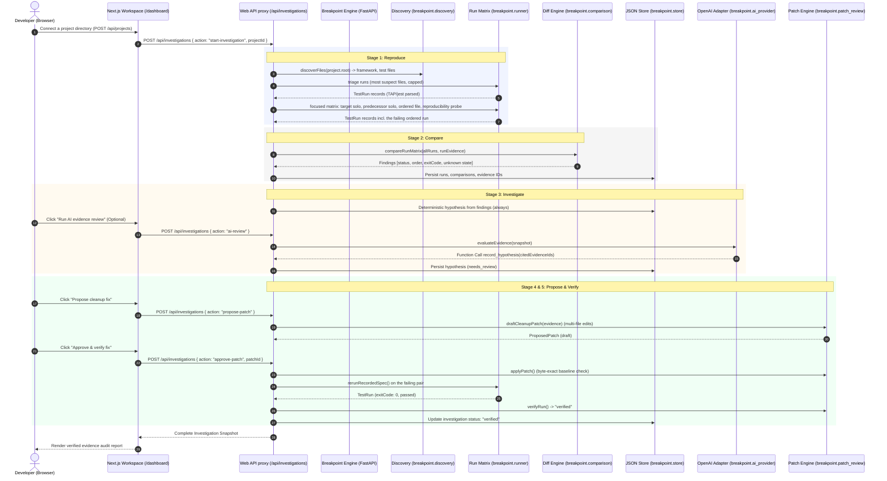

<p align="center">
  
</p>

<p align="center">
  <strong>Don't guess the bug. Prove it.</strong>
</p>

<p align="center">
  An evidence-first debugging workspace for inconsistent and order-dependent test failures.
</p>

<p align="center">
  <a href="https://github.com/pranavgawaii/codex-breakpoint/actions/workflows/ci.yml">
    
  </a>
</p>

---

## Quick Start (30 Seconds)

Breakpoint is a **standalone Python engine** (the product: service + CLI) with a **thin Next.js web client**. Both run locally with no API keys.

**Engine** (Python 3.12+):

```bash
cd engine
python3 -m venv .venv && source .venv/bin/activate
pip install -e ".[dev]"
breakpoint serve --port 8000              # engine API for the web UI
```

**Web client** (Node 20+):

```bash
npm install
npm run dev
```

Open [http://localhost:3000](http://localhost:3000) for the overview or [http://localhost:3000/app](http://localhost:3000/app) to connect a project — the bundled trusted samples (`sample-project/` for Node, `python-sample-project/` for pytest), or any local directory you register. If the Python engine service is in standby or offline, the web UI automatically enables the interactive sandbox simulation mode, allowing full UI exploration without blocking onboarding.

**No browser?** The engine is the product — use it headless:

```bash
breakpoint register ../python-sample-project --trust
breakpoint workflow                       # triage → matrix → comparison → hypothesis
breakpoint patch && breakpoint approve && breakpoint report
```

---

## The Problem

Every engineering team has encountered this scenario:

> A test passes reliably when run alone in isolation (`npm test -- test/session.test.js`), but fails unpredictably when executed as part of the full test suite (`npm test`).

Developers typically respond by:
1. Re-running the suite hoping it was a fluke.
2. Dumping pages of `console.log` statements into test files.
3. Guessing at race conditions or timing issues.
4. Asking an LLM to "fix the bug" without giving it execution context—often producing plausible-looking patches that fail when applied.

### Why this happens

In modern test suites, tests that share a process often share hidden state:
- **Module-level variables** mutated during authentication or caching.
- **Global mocks or singletons** that are not cleaned up in `afterEach` hooks.
- **Database or filesystem remnants** left behind by previous assertions.
- **Execution order dependencies** where Test B only passes if Test A ran beforehand, or fails if Test A ran first.

Reading static log dumps cannot prove causation because logs show what happened, not why the state diverged from the passing baseline.

---

## What Breakpoint Does

Breakpoint treats flaky test debugging like a forensic investigation rather than a guessing game:

1. **Executes Controlled Comparisons**: Runs the target test in isolation, the suspect test in isolation, the pair in original order, the pair in reversed order, and repeats the sequence.
2. **Collects Verifiable Evidence**: Parses machine-readable test events (TAP protocol) and binds findings to specific run identities (`run_xxx`).
3. **Labels Uncertainties Explicitly**: When application heap state was not captured, Breakpoint explicitly tags findings as `unknown` rather than hallucinating internal transitions.
4. **Constrains AI with Strict Evidence Citations**: When OpenAI review is enabled, the model can only formulate hypotheses by citing existing evidence IDs. If the model references an unobserved fact, the tool call is rejected by the server.
5. **Gates Fixes Behind Approval & Verification**: Generates a targeted cleanup patch, displays the exact diff, applies it only after human confirmation, and immediately re-runs the failing sequence to verify the fix.

---

## How It Works

Breakpoint follows a five-stage verification cycle:

```
┌─────────────┐     ┌───────────┐     ┌─────────────┐     ┌───────────┐     ┌──────────┐
│  Reproduce  │ ──► │  Compare  │ ──► │ Investigate │ ──► │  Propose  │ ──► │  Verify  │
└─────────────┘     └───────────┘     └─────────────┘     └───────────┘     └──────────┘
  Isolated vs         Differential       Evidence-Cited      Approval-Gated    Post-Patch
  Ordered Runs        Analysis           Hypotheses          Code Fix          Rerun
```

### Flow Architecture



---

## Key Features (Verified in Code)

- **Registered-Project Discovery (`breakpoint/discovery.py`)**: Walks a registered directory (capped), detects the test framework, and builds run commands from the project's own test files and binaries. The browser cannot supply arbitrary shell commands, working directories, or execution parameters.
- **Argv-Only Process Execution (`breakpoint/spawn_safe.py`)**: Executes real test runs using `child_process.spawn` with `shell: false`, a scrubbed child environment, and executable paths resolved from the project's own `node_modules/.bin`.
- **Process Safety Controls (`breakpoint/runner.py`)**: Enforces a strict execution timeout via `SIGKILL` and stdout/stderr byte-cap truncation; runs never inherit secrets from the server environment.
- **TAP/junitxml Output Parsers (`breakpoint/runner.py`)**: Ingests TAP output from Node's native test runner (`node --test`), jest-style summaries and pytest junitxml, extracting individual test names, run durations, exit codes, and failure assertion messages.
- **Static Shared-State Analysis (`breakpoint/state_analysis.py`)**: Python sources are scanned with the `ast` module (exact module-level assignments, mutating functions, reset candidates); JS sources via the ported noise-stripping scanner. Ranks suspect files and selects the investigation target before any run.
- **Differential Run Comparison Engine (`breakpoint/comparison.py`)**: Contrasts failing and passing runs across the matrix — status, exit codes, execution sequence, and assertion errors. Explicitly creates records with `certainty: "unknown"` for uncaptured runtime memory state.
- **Single-Tenant Operation Serialization (`breakpoint/lock.py`)**: Mutating actions (`run-workflow`, `ai-review`, `approve-patch`) are protected by an in-memory lock that returns HTTP 409 Conflict if a concurrent mutation is initiated.
- **Local-First Atomic Store (`breakpoint/store.py`)**: Persists runs, evidence, comparisons, analyses, and patches to `.breakpoint/investigations.json` using atomic temporary file creation (`mode 0o600`) and renaming, protecting against partial writes.
- **Constrained AI Function Calling (`breakpoint/ai_provider.py`)**: Integrates with OpenAI's Responses API using strict function definitions (`record_hypothesis`). Server-side validation requires that all cited supporting and contradicting evidence IDs exist in the active investigation; hallucinatory citations result in immediate rejection. Optional extra: `pip install -e ".[ai]"`.
- **Approval-Gated Safe Patching (`breakpoint/patch_review.py`)**: Patches are generated as immutable drafts holding per-file edits. Before writing to disk, Breakpoint verifies that every target file matches its recorded byte-exact baseline. An approval click is required to apply the patch, and a subsequent rerun must pass before marking the issue "verified".
- **One-Click Patch Rollback (`breakpoint/patch_review.py`)**: Restores every patched file's original baseline contents cleanly with a single click (`action: "revert-patch"`).

---

## Example Debugging Scenario

Breakpoint includes a real, reproduction-ready sample project in `sample-project/`.

### The Bug

In `sample-project/src/session.js`:

```javascript
let activeUser = null;

export function authenticate(user) { activeUser = user; }
export function currentUser() { return activeUser; }
export function clearSession() { activeUser = null; }
```

In `sample-project/test/session-flow.test.js`:

```javascript
import test from "node:test";
import assert from "node:assert/strict";
import { authenticate, currentUser } from "../src/session.js";

test("authentication establishes the demo user", () => {
  authenticate("demo-user-1");
  assert.equal(currentUser(), "demo-user-1");
});

test("session starts without a user", () => {
  assert.equal(currentUser(), null, "session should be empty at test setup");
});
```

### The Failure Sequence

1. **Isolation Run**: Running only `session starts without a user` succeeds:
   ```bash
   node --test --test-name-pattern "session starts without a user" test/session-flow.test.js
   # Result: ✔ session starts without a user (exit code: 0)
   ```
2. **Sequential Suite Run**: Running the full test file fails:
   ```bash
   node --test test/session-flow.test.js
   # 1. authenticate establishes the demo user -> PASS (mutates activeUser to "demo-user-1")
   # 2. session starts without a user -> FAIL (assertion error: 'demo-user-1' !== null)
   ```
3. **Reversed Sequence Run**: Running in reverse order in `test/reverse-flow.test.js` succeeds:
   ```bash
   node --test test/reverse-flow.test.js
   # 1. session starts without a user -> PASS (activeUser was null)
   # 2. authenticate establishes the demo user -> PASS
   ```

### How Breakpoint Proves It

- Runs all three variations back-to-back and records stdout/stderr, durations, and TAP events.
- Compares Run 3 (failing ordered run) against Run 4 (passing reversed run).
- Discovers that the test failure is strictly order-dependent, linking the finding to evidence IDs `ev_xxx`.
- Proposes a cleanup patch to reset state between runs:
  ```diff
  + test.beforeEach(() => clearSession());
  ```
- Applies the patch, reruns the failing ordered pair, confirms exit code 0, and archives the investigation as **Verified**.

The same flow runs unchanged against the **pytest sample** in `python-sample-project/`: `billing._ledger` is the module-level state, `test_expected_total` is the failing target, and the drafted patch wires the existing `reset_ledger()` into an autouse fixture (see [`python-sample-project/README.md`](python-sample-project/README.md)).

---

## Technology Stack

Derived directly from `package.json` and active code:

| Component | Technology | Purpose |
|---|---|---|
| **Engine** | Python 3.12+ (stdlib-first) | The product: discovery, static analysis, run matrix, comparison, patch engine, atomic store. `ast`-based scanning for Python sources, ported scanner for JS/TS. |
| **Engine Service** | FastAPI + Uvicorn | Same JSON API the web UI consumes, plus Server-Sent-Events live run streaming (`/api/events`). |
| **Engine CLI** | Typer | `breakpoint register/scan/workflow/patch/approve/revert/report/serve` — the full product headless. |
| **Test Runners** | pytest (junitxml), `node --test` (TAP), jest, vitest | Executed as argv-only subprocesses; output parsed into per-test records. |
| **Web Client** | Next.js 15.5.28 (App Router), React 19 | Thin client: proxies `/api/*` to the engine (`BREAKPOINT_ENGINE_URL`, default `127.0.0.1:8000`). |
| **Client Language** | JavaScript (ESM) | Zero-TypeScript in the client; shapes documented in `engine/breakpoint/` docstrings. |
| **AI Integration** | OpenAI Python SDK (optional extra `ai`) | Structured hypothesis evaluation via the Responses API with function-tool constraints. |
| **Styling** | Vanilla CSS | Bespoke design system based on warm paper aesthetic, Outfit and Redaction 35 typography, and hairline borders. |
| **Persistence** | Python `json` + atomic `os.replace` | Engine store at `.breakpoint/investigations.json` (mode 0600), owner-only permissions. |

---

## Getting Started

### Prerequisites

- **Node.js**: v20.0.0 or higher (required for native `node --test` runner).
- **npm**: v10.0.0 or higher.
- **Git**

### Installation

1. Clone the repository:
   ```bash
   git clone https://github.com/pranavgawaii/codex-breakpoint.git
   cd codex-breakpoint
   ```

2. Install the web client and the engine:
   ```bash
   npm install                             # web client
   cd engine
   python3 -m venv .venv && source .venv/bin/activate
   pip install -e ".[dev]"                 # engine (add ,ai for AI review)
   cd ..
   ```

3. Engine environment variables (optional):
   ```bash
   # Only for AI-assisted evidence review (engine venv)
   export OPENAI_API_KEY=your_openai_api_key_here
   export OPENAI_MODEL=gpt-4.1-mini       # optional model override

   # Engine store directory (defaults to .breakpoint/)
   # export BREAKPOINT_DATA_DIR=/path/to/custom/dir

   # Web client -> engine URL (default is fine locally)
   # export BREAKPOINT_ENGINE_URL=http://127.0.0.1:8000
   ```

   > **Note**: An OpenAI API key is **not required** to use Breakpoint. The full five-step controlled workflow, differential comparison engine, deterministic hypothesis generation, patch proposal, and fix verification operate 100% locally and deterministically. `OPENAI_MODEL` defaults to `gpt-4.1-mini`.

4. Start the development server:
   ```bash
   npm run dev
   ```

   Navigate to [http://localhost:3000](http://localhost:3000).

---

## Project Structure

```
codex-breakpoint/
├── engine/                                 # The product: Python engine (service + CLI)
│   ├── pyproject.toml                      # `breakpoint-debug` package definition
│   ├── README.md                           # Engine-specific quick start
│   ├── breakpoint/                         # The engine package
│   │   ├── api.py                          # FastAPI app: /api/projects, /api/investigations, /api/events (SSE)
│   │   ├── cli.py                          # Typer CLI: register, scan, workflow, patch, approve, revert, report, serve
│   │   ├── agent.py                        # Deterministic hypothesis builder
│   │   ├── ai_provider.py                  # Optional OpenAI Responses adapter (evidence-cited)
│   │   ├── comparison.py                   # Matrix-aware differential run comparison
│   │   ├── discovery.py                    # File walk, framework detection (pytest/node/jest/vitest), argv builder
│   │   ├── errors.py                       # Typed application errors (Conflict, Forbidden, ...)
│   │   ├── events.py                       # In-process pub/sub for the SSE live stream
│   │   ├── investigations.py               # Orchestrator: all 8 actions
│   │   ├── lock.py                         # Single-tenant operation lock (409 on overlap)
│   │   ├── patch_review.py                 # Unified diff, byte-exact baseline apply/revert, verifier
│   │   ├── projects.py                     # Registration safety gates + analysis entry
│   │   ├── runner.py                       # Triage/matrix specs, TAP/jest/junitxml parsers
│   │   ├── spawn_safe.py                   # Argv-only subprocess (no shell, scrubbed env, output caps)
│   │   ├── state_analysis.py               # Shared-state scanner (ast for Python, ported scanner for JS)
│   │   └── store.py                        # Atomic JSON persistence (.breakpoint/investigations.json)
│   └── tests/                              # The engine's own pytest suite (16 tests)
├── app/                                    # Next.js web client (thin proxy to the engine)
│   ├── api/engine-client.js                # Engine proxy helper (BREAKPOINT_ENGINE_URL)
│   ├── api/projects/route.js               # REST proxy: list + register local projects
│   ├── api/investigations/route.js         # REST proxy: workflow, triage, AI review, patches
│   ├── app/page.jsx                        # Project connector (register any local directory)
│   ├── components/                         # Reusable UI components
│   │   ├── brand-mark.jsx                  # SVG brand marks and glyphs
│   │   ├── diff-view.jsx                   # Patch diff inspector
│   │   ├── investigation-window.jsx        # Embedded interactive demo window
│   │   ├── product-chrome.jsx              # Global navigation and status indicators
│   │   └── site-footer.jsx                 # Clean editorial footer
│   ├── dashboard/                          # Interactive investigation workspace
│   │   ├── dashboard.css                   # Workspace-specific stylesheets
│   │   ├── page.jsx                        # Dashboard route entry point
│   │   └── workspace.jsx                   # Guided flow, run tabs, patch reviewer
│   ├── investigations/
│   │   ├── inv_session_state/              # Legacy route -> workspace; forensic summary report
│   │   └── new/page.jsx                    # Fixed execution-matrix run plan
│   ├── layout.jsx                          # Root layout and font declarations
│   ├── not-found.jsx                       # 404 error page
│   ├── page.jsx                            # Landing page with interactive live demo
│   ├── runtime.css                         # Utility and layout styling
│   └── styles.css                          # Design system tokens and typography
├── sample-project/                         # Trusted Node sample (order-dependent session state)
│   ├── src/session.js                      # Source with shared module-level state
│   └── test/                               # session-flow (fails in order) / reverse-flow (passes)
├── python-sample-project/                  # Trusted pytest sample (order-dependent ledger)
│   ├── billing.py                          # Module-level _ledger + exported mutators/reset
│   └── tests/test_ledger_flow.py           # Failing ordered pair
├── public/brand/                           # SVG and PNG brand marks
├── package.json                            # Web client dependencies, build scripts, ESM marker
└── jsconfig.json                           # Path alias (@/*) configuration
```

---

## API Surface

### `POST /api/projects`
| Field | Notes |
|---|---|
| `root` | Absolute path of a directory on this machine. Must exist, must not sit inside a forbidden system root (`/etc`, `/usr`, `/bin`, ...). |
| `trusted` | Opt-in confirmation that Breakpoint may execute this project's tests and, only after explicit patch approval, write inside it. |

Returns `{ project, discovery: { framework, testFiles, truncated } }`.

### `GET /api/investigations`
Returns the active investigation snapshot: investigation record (including the resolved `target`), owning project, public runs, evidence, comparisons, static analyses, hypotheses, patches and verifications.

### `POST /api/investigations` actions
| Action | Body | Effect |
|---|---|---|
| `start-investigation` | `{ projectId }` | Creates a fresh investigation for a registered project and makes it active. |
| `scan-project` | `{ projectId? }` | Runs the static shared-state analysis only (no subprocesses) and persists findings as evidence. |
| `run-workflow` | `{ testFile?, targetTest? }` | Full pipeline: static triage → triage runs → resolved target → focused matrix → comparison → hypothesis. |
| `run-demo` | — | Legacy alias of `run-workflow` against the bundled trusted sample. |
| `ai-review` | — | Optional. OpenAI reviews the evidence trail and records a hypothesis via one function call. |
| `propose-patch` | — | Drafts a minimal multi-file cleanup patch from evidence; stays unapplied. |
| `approve-patch` | `{ patchId }` | Applies the draft (byte-exact baseline check), reruns the failing pair, records verification. |
| `revert-patch` | `{ patchId }` | Restores every patched file to its baseline; records the revert. |

---

## Available Scripts

All scripts have been verified and tested:

```bash
# Web client (from the repo root)
npm run dev                   # local development server
npm run lint                  # lint all source files
npm run build                 # production build
npm run start                 # production server

# Engine (from engine/ with the venv active)
breakpoint serve --port 8000  # engine API for the web UI
breakpoint register <root> --trust
breakpoint workflow           # full pipeline headless
breakpoint patch              # draft the cleanup patch
breakpoint approve            # apply + verify
breakpoint revert             # roll back
breakpoint report             # print the audit trail
python -m pytest tests/ -q    # run the engine's own test suite

# The bundled samples directly
node --test sample-project/test/session-flow.test.js
cd python-sample-project && python3 -m pytest tests/ -v
```

---

## Architecture and Security

### Subprocess Execution Model

Breakpoint runs test commands from the engine using `subprocess.Popen` via `engine/breakpoint/spawn_safe.py`:
- **Shell-free execution**: argv arrays only with `shell=False` — input strings are never parsed or expanded by bash/sh, eliminating shell injection vulnerabilities.
- **Project-local binaries**: pytest runs use the project's own virtualenv interpreter when present; jest/vitest binaries come from the project's `node_modules/.bin`; commands are built by the engine from discovered test files. The browser can never specify arbitrary arguments or executables.
- **Registered working directory**: Execution is locked to the registered project root. Registration rejects paths inside forbidden system roots (`/etc`, `/usr`, `/bin`, `/sbin`, `/System`, ...).
- **Sanitized environment**: Subprocesses receive a minimal, scrubbed environment (`TZ: UTC`, `PYTHONDONTWRITEBYTECODE`, capped `NODE_OPTIONS`) with no secrets forwarded.
- **Hard output caps and timeouts**: Every run has a wall-clock timeout (process-group kill) and stdout/stderr byte caps, recorded verbatim in the store.

### Important Security Boundary Disclosures

> **Warning: The engine runs test subprocesses on the host machine.**
> 
> Ordinary child process execution with restricted parameters is a **harness boundary**, not a **virtualized sandbox**. Subprocesses running on the host retain filesystem access permitted by user permissions. 
> 
> Do not point Breakpoint at untrusted third-party repositories or execute unknown scripts outside a hardened virtual container (e.g., Docker, Firecracker, or gVisor).

### AI Security & Prompt Injection Mitigation

1. **Schema-enforced function calling**: OpenAI is strictly invoked using structured tool parameters (`record_hypothesis`). Free-form text output is ignored in favor of validated tool arguments.
2. **Evidence ID validation**: The server verifies that every ID passed in `supportingEvidenceIds` and `contradictingEvidenceIds` exists in `.breakpoint/investigations.json`. Hallucinated IDs cause immediate rejection.
3. **Prompt boundary enforcement**: Test outputs and repository contents are provided as structured data values, never as prompt instructions.
4. **Zero execution privileges for AI**: The AI model has no tool access to run commands, edit files, or mark investigations as verified. Only human user actions can approve patches or trigger runs.

---

## Current Status & Limitations

### Working Today
- **Standalone Python engine** (FastAPI service + Typer CLI): the full product works with or without the web UI.
- **pytest first-class**: junitxml ingestion, `file::test` node-id narrowing, `ast`-based Python source analysis, project-venv interpreter preference.
- **Node suites**: `node --test` (TAP), jest, vitest via their native binaries with the same pipeline.
- Any local directory can be registered (with explicit trust confirmation) and investigated — not just the bundled samples.
- Static shared-state analysis produces ranked, evidence-backed findings without executing anything.
- Live run streaming over Server-Sent Events (`GET /api/events`).
- Differential comparison across the run matrix with explicit "unknown" markers.
- Deterministic hypothesis formulation with cited analysis evidence.
- Optional OpenAI Responses API integration with verified evidence citation.
- Multi-file, baseline-checked, approval-gated patch proposal, application, and reversion.
- Post-fix rerun and verification recording against the exact recorded run spec.
- Strict action parameter validation (`projectId` required for `start-investigation`, `patchId` required for `approve-patch` and `revert-patch`).
- Comprehensive UI workspace with resilient offline simulation sandbox and forensic summary report.

### Current Limitations
- **Subprocess Isolation**: Runs locally on the host; not containerized in Docker. Trust confirmation gates execution, but it is not a sandbox.
- **Go / Rust suites**: `go test` and `cargo test` adapters are planned; the engine's adapter model accepts any argv + parser pair.

---

## Roadmap

- [ ] **Docker / MicroVM Sandboxing**: Execute test commands inside ephemeral containers to safely analyze untrusted repositories.
- [ ] **More Runner Adapters**: Go (`go test -json`), Rust (`cargo test -- --format=json`).
- [ ] **PyPI Publish**: Ship `breakpoint-debug` for `pipx install` distribution.
- [ ] **Automated Bisecting for Order Dependencies**: Automatically execute permutations of test sequences to isolate the exact predecessor test that causes state corruption.
- [ ] **GitHub Actions / CI Bot**: Run Breakpoint automatically when a flaky test failure is detected in CI, attaching a full investigation snapshot to the pull request.

---

## Hackathon Context

Breakpoint was created for the **DevDay Exchange Community Metro Hackathon: Pune** (Codex-powered build sprint).

- **Track**: Developer Tools / Software Reliability
- **Core Premise**: Moving beyond generative "code assistants" that guess bug fixes, toward structured developer tools that gather forensic evidence, reproduce failure conditions, and verify code fixes with actual test runs.
- **Pitch Deck**: [View Breakpoint Pitch Deck (6 slides, PDF)](docs/breakpoint-pitch-deck.pdf)

---

## License

All rights reserved — see [`LICENSE`](LICENSE). This project was developed for a hackathon demonstration and is publicly viewable for evaluation only.

Font assets in `public/fonts/` (Outfit, Redaction 35) are licensed under the [SIL Open Font License 1.1](public/fonts/LICENSE-OFL-1.1.txt). See [`public/fonts/FONT-LICENSES.md`](public/fonts/FONT-LICENSES.md) for full attribution.
